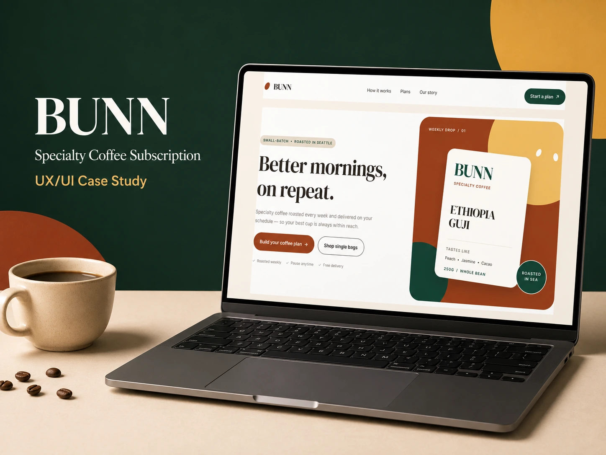
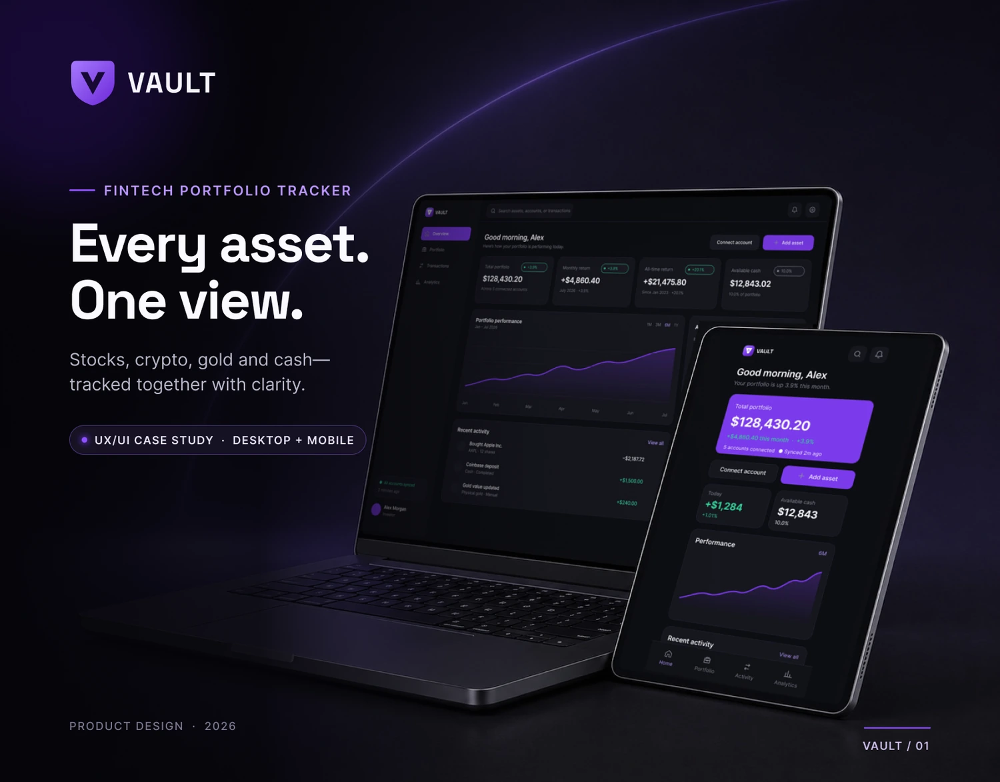
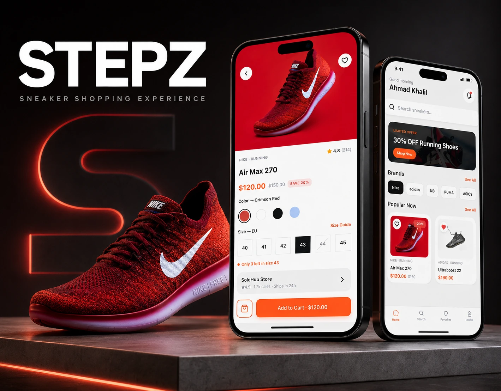
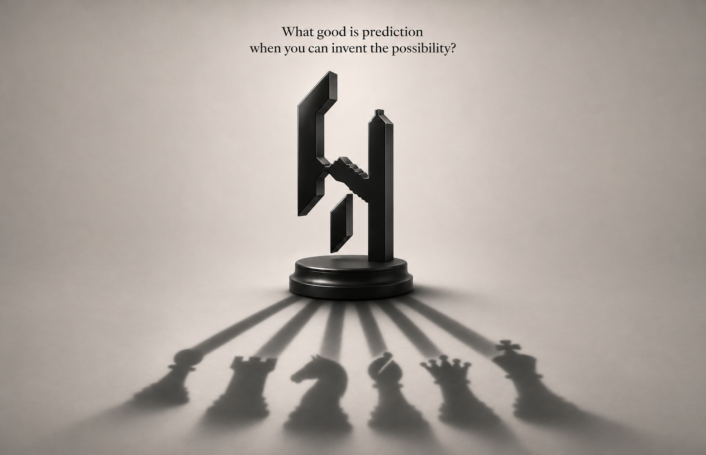

<!-- AH Signature — Product Design profile. Artwork and logo supplied by Abd Al Hade. -->

<picture>
  <source media="(prefers-color-scheme: dark) and (max-width: 600px)" srcset="./assets/ah-hero-dark-mobile.svg" />
  <source media="(prefers-color-scheme: light) and (max-width: 600px)" srcset="./assets/ah-hero-light-mobile.svg" />
  <source media="(prefers-color-scheme: light)" srcset="./assets/ah-hero-light.svg" />
  <source media="(prefers-color-scheme: dark)" srcset="./assets/ah-hero-dark.svg" />
  
</picture>

# Abd Al Hade

**Product Designer · UX/UI**

[**View my work**](#selected-work) · [**Behance**](https://behance.net/abdalhadehania) · [**LinkedIn**](https://linkedin.com/in/abdalhadehania) · [**Email**](mailto:abdalhadehania2005@gmail.com)

---

## Selected Work

Independent design projects across subscription, financial dashboards, and mobile commerce.

### BUNN — Specialty Coffee Subscription

**The interface explores:** Coffee plan selection, product details, and recurring delivery.

[**Explore the BUNN case study on Behance**](https://www.behance.net/gallery/252598363/BUNN-Specialty-Coffee-Subscription-UXUI-Case-Study)

### VAULT — Fintech Portfolio Tracker

**The interface explores:** Making stocks, crypto, gold, and cash visible within a shared portfolio overview on desktop and mobile.

[**Explore the VAULT case study on Behance**](https://www.behance.net/gallery/252645297/VAULT-Fintech-Portfolio-Tracker-UXUI-Case-Study)

### STEPZ — Sneaker Shopping Experience

**The interface explores:** Sneaker browsing, size and color selection, and adding a product to cart.  
*Independent concept; not affiliated with Nike or the other brands pictured.*

---

## The Idea Behind My Mark

The same form casts several different chess-piece shadows. For me, it is a reminder to explore more than one perspective before making a product-design decision.

## Between Design and Development

I study **Mobile Applications Design & Programming**. That foundation helps me consider how an interface is experienced and how it can be implemented.

  
<strong>Design and technical toolkit</strong>

  - **Design:** Figma, wireframes, user flows, interface design, design systems.
  - **Development foundation:** Java, Android, HTML, CSS, JavaScript, PHP/Laravel, MySQL, SQLite, Git and GitHub.

